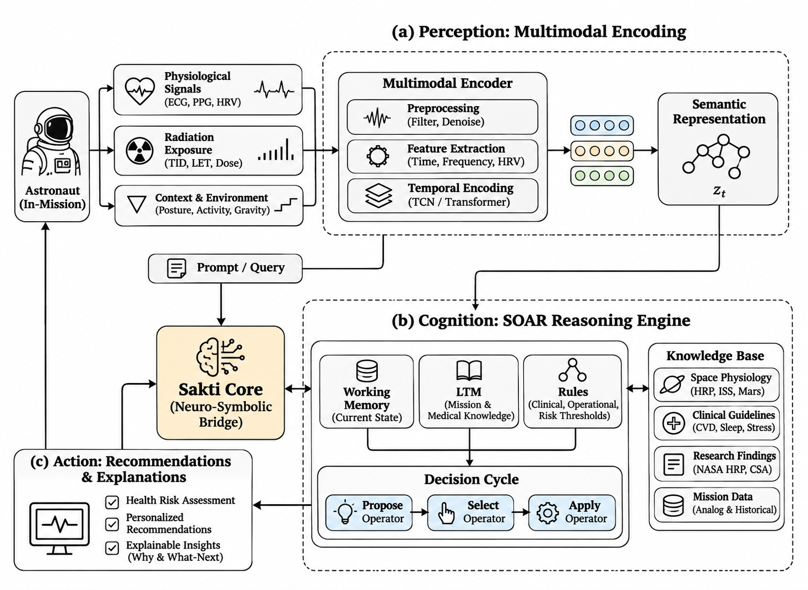
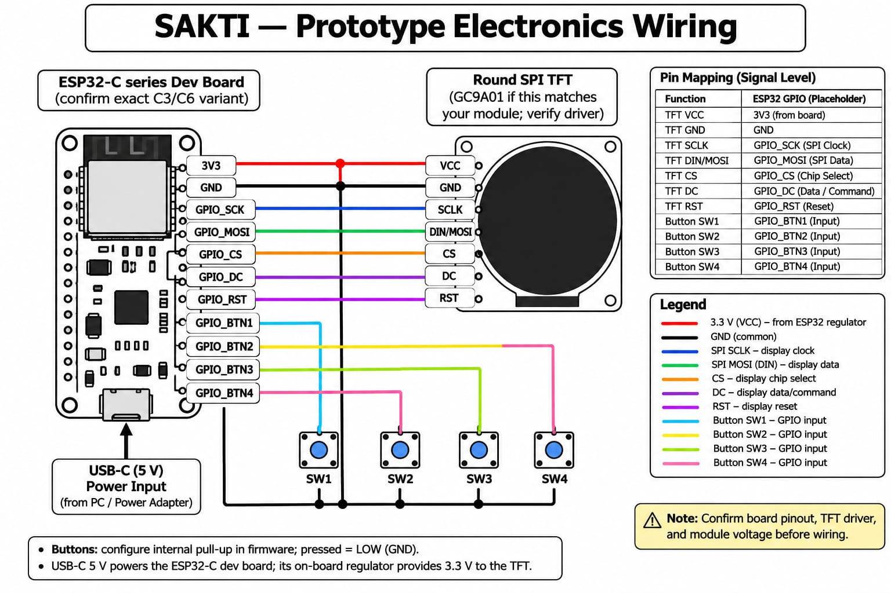

# SAKTI (ASTRA-HEALTH)

**A modular astronaut health-monitoring prototype combining mechanistic cardiovascular simulation and wearable physiological-signal models.**
Team Star Busters, University of Lucknow — NASA Space Apps Challenge 2026, *Create Health Monitoring Software for Astronauts on Space Missions*.

SAKTI learns each astronaut's own baseline, shows which body systems are changing, and gives a clear next step. Its central component, **GRAVITY-HEART**, is a personalised, physics-based model of the circulation that estimates how blood pressure responds to standing after time in weightlessness, on the Moon, on Mars, or on Earth.

> **[Read the SAKTI Research Paper (PDF)](SAKTI_Research_Paper.pdf)**  
> 8-page research paper covering the cardiovascular model, wearable system, evaluation results, and medical decision-support boundaries.  
> **[Open PDF](https://github.com/HarshPrajapati7/Shakti/blob/main/SAKTI_Research_Paper.pdf)** · **[Download PDF](https://github.com/HarshPrajapati7/Shakti/raw/main/SAKTI_Research_Paper.pdf)**

## Try it now

- **Windows desktop application (one click):** download [`sakti.exe`](https://github.com/HarshPrajapati7/Shakti/releases/download/v1.0.0/sakti.exe) and run it. No installation or network is required.
- **Video demonstration:** https://youtu.be/w6IXvcISsVY
- **Research paper (PDF):** [read it here](SAKTI_Research_Paper.pdf) · [direct download](https://github.com/HarshPrajapati7/Shakti/raw/main/SAKTI_Research_Paper.pdf)
- **Web build (any OS, Node 20+):**
  ```powershell
  cd apps\web; npm ci; npm run dev     # http://localhost:5173
  ```
- **Build the desktop app from source (Node 20+, Rust, Visual Studio C++ Build Tools):**
  ```powershell
  .\build-app.ps1                        # builds the UI and the native Tauri app -> sakti.exe
  ```

The application opens with a loading screen, offers a 14-day sample crew record, and runs every model natively through a Rust engine.

## System architecture



The figure shows the target architecture: a perception layer that encodes physiological, radiation, and context signals; a cognition layer that reasons over clinical and operational rules; and an action layer that returns risk assessments, recommendations, and explanations. The **current build implements the parts that can be evaluated today**: three independently trained specialist models exposed through one local runtime, combined with reference-range and robust-baseline rules. The multimodal encoder and the symbolic reasoning engine in the diagram describe the intended direction, not a trained end-to-end model; treating unrelated public datasets as a single synchronized astronaut cohort would be an invalid training design, so the models are kept separate and connected through the application.

| Module | What it does | Data (real) | Result (subjects never seen in training) |
|---|---|---|---|
| GRAVITY-HEART | Personal hydrostatic and baroreflex circulation model; gravity scenarios and countermeasures | PhysioNet PRCP, 10 subjects, 59 manoeuvres | Personalised error 6.21 bpm / 6.26 mmHg vs 8.05 / 7.61 population (p = 0.002 / 0.010) |
| PPG-HR | Wrist heart rate under motion, with calibrated uncertainty | PPG-DaLiA, 15 subjects | 4.46 bpm MAE online, 3.82 offline (classical tracker 13.95) |
| STRESS | Physiological stress versus a personal rest baseline | WESAD, 15 subjects | macro-F1 0.952 chest, 0.919 wrist (Schmidt et al. 2018: 0.912) |

Every number is read from `results/*/metrics.json`. Full tables are in `reports/tables`, figures in `reports/figures`. The STRESS branch is evaluated offline and is not yet dispatched by the runtime; the dashboard therefore does not expose a live stress endpoint.

## The mathematics

### GRAVITY-HEART

The cardiovascular response to a change in gravitational loading is a reduced-order dynamical system. The head-to-foot gravity input and its hydrostatic pressure scale are

```
u(t)      = (g_local / g_E) · sin φ(t)
ΔP_h(t)   = ρ · g_E · h · u(t)
```

with `g_E = 9.80665 m/s²`, blood density `ρ = 1060 kg/m³`, and an effective vessel-height term `h` (pressures are converted using 133.322 Pa/mmHg). A fast venous-pooling state `V_f` and a slower transcapillary-filtration state `V_s` follow first-order dynamics driven by `u`, and set the central stressed volume `V_cs`. Relative stroke volume uses a saturating Frank–Starling relation, and mean arterial pressure couples heart rate, stroke volume, and total peripheral resistance:

```
MAP(t) = MAP0 · (HR/HR0) · (SV/SV0) · (1 + δTPR) · (1 − v_d)
```

Baroreflex and cardiopulmonary feedback drive saturating `tanh` effector targets for heart rate and resistance, which approach their targets with time constants `τ_HR` and `τ_TPR`. Eleven positive parameters are fitted in log space under a log-normal prior by bounded nonlinear least squares with a pseudo-Huber loss on standardised HR and MAP residuals, giving a maximum-a-posteriori estimate. Ablations compare a zero-response baseline, a ridge FIR predictor, a population fit, a personalised fit, and a personalised fit with an empirical-Bayes hierarchical prior, all under leave-one-manoeuvre-out evaluation. Parameter uncertainty uses a Laplace approximation from `(JᵀJ)⁺`.

### PPG-HR

Each estimate uses an eight-second wrist BVP window at 64 Hz and a synchronous three-axis accelerometer window, advanced by two seconds, with seven windows of context. A convolutional ensemble produces a distribution over 224 heart-rate bins (≈30–239 bpm). A hidden Markov model with Gaussian log-rate transitions tracks the rate causally through a forward belief update,

```
α_t(k) ∝ p_t(k) · Σ_j α_{t−1}(j) · T(k | j)
```

where `p_t(k)` is the CNN probability of bin `k` and `T(k|j)` the transition probability. Offline forward–backward smoothing is reported as a non-causal comparator. Cross-subject split-conformal calibration sets the prediction-interval width. Evaluation is leave-one-subject-out over all 15 participants.

### STRESS and personal baselines

For a measured variable `x_j`, the personal baseline is the median `m_j` with a robust scale from the median absolute deviation,

```
s_j = max(1.4826 · MAD(x_j), 0.06·|m_j|, 1e-6)
z_j = (x_j − m_j) / s_j
```

A personal deviation can raise a status level but never lowers a range-based warning. The WESAD stress branch classifies 60-second windows against the first five minutes of each subject's rest, excluded from scoring.

## Hardware prototype

SAKTI drives a round, wearable-form-factor display from an ESP32-C development board. The firmware and the full wiring, API contract, and suit-integration plan are in [`firmware/`](firmware/README.md).



The core idea is that the wearable attaches **directly to the suit** and reads physiological telemetry over a wired bus, with no radio in the loop. The firmware separates rendering from the data source behind one interface, so the transport is a build-time choice:

- **Direct suit bus** (`suit_source.cpp`): the operational design. A CRC-checked frame is read over a wired UART/CAN link from the suit avionics.
- **WiFi + HTTP/JSON** (`wifi_source.cpp`): a **demonstration transport only**, so the display can show live output on a bench without a suit.

The display shows status, heart rate, SpO2, blood pressure, a heart-rate trend, and the next Mission-Protocol task. Four buttons switch views and refresh.

## Mission Protocols (health gamification)

The **Mission** page turns recurring astronaut health activities into short, mission-themed objectives: suit-up and EVA readiness, deep-space transit and arrival, surface traverse and recovery, and a long-duration daily routine. It rewards *reliable health-maintenance behaviour and measurement quality, not a favourable health result*: an honestly recorded abnormal measurement still earns completion points and always opens the correct health pathway. A health alert suspends gamification and takes priority. Points, levels, and badges track participation only and never change clinical thresholds or model outputs. Daily adherence is

```
C_d = 100 · (completed tasks on day d) / (scheduled tasks on day d)
```

with a seven-day rolling mean; days without scheduled tasks are gaps rather than zeros. A separate physiological-trajectory view plots real measurements with source labels and the robust personal deviation `z` above. Progress is stored locally and works offline. The feature is implemented in `apps/web/src/lib/mission.ts` and `apps/web/src/pages/Mission.tsx`; the full blueprint is in `SAKTI_MISSION_PROTOCOLS_SPEC-1.md`.

## Quick start (research pipeline)

```powershell
py -3.9 -m venv --system-site-packages .venv          # CUDA torch 2.2.2, see requirements.txt
.\.venv\Scripts\python.exe -m pip install -r requirements.txt
.\.venv\Scripts\python.exe scripts\run_pipeline.py --smoke   # 3-minute check that everything runs
.\.venv\Scripts\python.exe scripts\run_pipeline.py           # full training (~3-4 h on an RTX 4050)
cd apps\web; npm install; npm run dev                        # dashboard at http://localhost:5173
```

Datasets are located automatically in this folder or its parent: `prcp-1.0.0.zip`, `cardioresp-response-orthostat-1.0.zip`, `ppg+dalia.zip`, `WESAD.zip`.

## Repository

```
src/astra/gravity/     GRAVITY-HEART model, data pipeline, fitting
scripts/               run_pipeline, train_*, edge_tests, make_figures, export_web_data, build_notebook
notebooks/             ASTRA_HEALTH_training.ipynb (runnable, judge-facing)
models/  results/      trained artefacts (.json/.pt/.onnx/.txt) and metrics
reports/               paper-ready figures (PNG + PDF) and tables (CSV + LaTeX)
apps/web/              React + Vite + Tailwind + react-three-fiber dashboard (includes the Mission page)
engine/                Rust inference core (astra-core) and the Tauri desktop app (sakti-app)
firmware/              ESP32-C + GC9A01 round-watch firmware and its documentation
docs/                  architecture and wiring diagrams
```

## Evaluation protocol

Leave-one-subject-out for PPG-DaLiA and WESAD. Leave-one-manoeuvre-out, with a hierarchical prior from *other* subjects, for GRAVITY-HEART personalisation. Simple baselines are reported next to every model, alongside a 13-case edge test suite and a TypeScript/Python numerical-equivalence test. All reduced-gravity outputs are simulations extrapolated from Earth-based posture data and are labelled as such. SAKTI is a research decision-support prototype, not a certified medical device.

## Credits

NASA Human Research Program hazard and risk framework · PhysioNet PRCP (Heldt et al.) · PPG-DaLiA (Reiss et al., CC BY 4.0) · WESAD (Schmidt et al., non-commercial research use) · Body model: three.js examples (Mixamo Xbot).
